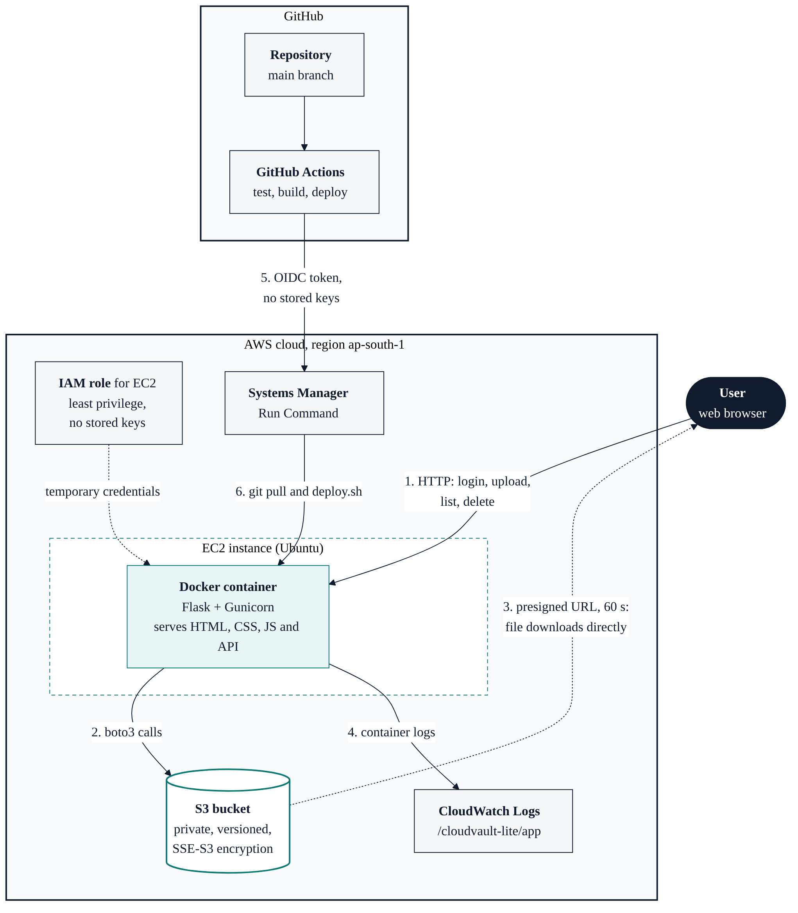

# CloudVault Lite

A small, secure cloud file storage app. Users log in, upload files to a private Amazon S3 bucket, list them, download them through short-lived links, and delete them. It runs in a Docker container on AWS EC2 and is deployed automatically from GitHub.

Built as the Cloud Computing major project for Quillance Infotech.

**Live demo:** `http://13.233.158.122` 



## Features

- Login with username and password (passwords stored as Werkzeug hashes in SQLite)
- Upload files (PDF, PNG, JPG, JPEG, TXT, DOCX, up to 10 MB)
- List, download and delete your own files
- Every user is limited to their own folder in the bucket (`users/<username>/`)
- Downloads use presigned S3 URLs that expire after 60 seconds, so the bucket itself is never public
- Files are encrypted at rest (SSE-S3, AES-256) and the bucket has versioning turned on
- Responsive single-page dashboard in plain HTML, CSS and JavaScript
- Automated tests, Docker image, CI/CD pipeline and centralised logs

## Technology stack

| Area | Technology |
| --- | --- |
| Backend | Python 3.14, Flask, Gunicorn |
| Cloud SDK | boto3 |
| Storage | Amazon S3 (private bucket, versioned, SSE-S3) |
| User data | SQLite (users table) |
| Frontend | HTML, CSS, vanilla JavaScript, Jinja templates |
| Compute | Amazon EC2 (Ubuntu), Docker |
| Access control | IAM least-privilege policies, EC2 instance role |
| CI/CD | GitHub Actions, OIDC federation to AWS, AWS Systems Manager Run Command |
| Monitoring | Amazon CloudWatch Logs (Docker `awslogs` driver) |
| Tests | pytest with an in-memory fake S3 |

## How it works

1. The browser talks to the Flask app over HTTP (login, upload, list, delete).
2. The app calls S3 through boto3. On EC2 it gets temporary credentials from the instance role, so no access keys are stored anywhere.
3. For a download, the app checks the file belongs to the logged-in user and returns a presigned URL. The browser then downloads straight from S3.
4. Container logs (logins, uploads, downloads, deletes, failed logins) go to CloudWatch Logs.
5. On every push to `main`, GitHub Actions runs the tests and builds the image. If they pass, it proves its identity to AWS with an OIDC token (no stored keys).
6. Systems Manager then runs `git pull` and `deploy.sh` on the instance, which rebuilds and restarts the container. No inbound SSH is needed for deployment.

## API

| Method | Path | Purpose |
| --- | --- | --- |
| GET | `/` | Dashboard (redirects to `/login` when logged out) |
| GET | `/login` | Login page |
| GET | `/health` | Health check, returns `{"status": "ok"}` |
| POST | `/api/login` | Log in with JSON `{username, password}` |
| POST | `/api/logout` | Log out |
| GET | `/api/me` | Current user |
| GET | `/api/files` | List your files |
| POST | `/api/upload` | Upload a file (multipart form field `file`) |
| GET | `/api/download/<name>` | Get a 60-second presigned download URL |
| DELETE | `/api/files/<name>` | Delete a file |

All `/api/*` routes except login return `401` when not logged in.

## Repository layout

```
app.py                  Flask app: routes, auth, S3 calls, create-user command
templates/              index.html (dashboard), login.html
static/                 app.js, login.js, style.css, favicon.svg
tests/test_app.py       12 tests using a fake S3 client
Dockerfile              Python 3.14 slim image, runs as a non-root user
deploy.sh               Rebuild and restart the container on the server
.github/workflows/      deploy.yml: test, build and deploy pipeline
docs/                   Architecture diagram (PNG and Mermaid source)
.env.example            Template for the environment file
requirements.txt        Runtime dependencies
requirements-dev.txt    Runtime dependencies plus pytest
```

## Configuration

Settings come from environment variables (a `.env` file locally and on the server). Copy `.env.example` to `.env` and fill it in. Never commit `.env`.

| Variable | Default | Meaning |
| --- | --- | --- |
| `SECRET_KEY` | `dev-only-change-me` | Signs session cookies. Set a long random value in production. |
| `BUCKET_NAME` | `cloud-vaultbucket` | Name of the S3 bucket |
| `AWS_REGION` | `ap-south-1` | Region of the bucket |
| `DB_PATH` | `users.db` | Location of the SQLite file (`/data/users.db` in Docker) |

Generate a secret key with:

```bash
python3 -c "import secrets; print(secrets.token_hex(32))"
```

## Run locally

Requirements: Python 3.12 or newer, and AWS credentials that can access the bucket (for example `aws configure` with a least-privilege IAM user).

```bash
git clone https://github.com/Balaram13-1/cloudvault-lite.git
cd cloudvault-lite
python3 -m venv venv
source venv/bin/activate
pip install -r requirements.txt

cp .env.example .env          # then edit the values
flask --app app create-user alice@example.com   # asks for a password (8+ characters)
flask --app app run
```

Open http://127.0.0.1:5000/ and log in.

## Run the tests

```bash
pip install -r requirements-dev.txt
python -m pytest -q
```

The tests replace S3 with an in-memory fake, so they need no AWS account. They cover authentication, per-user isolation, upload validation, filename sanitising, presigned downloads, deletion, security headers and logging of failed logins.

## Run with Docker

```bash
docker build -t cloudvault-lite .
docker run -d --name cloudvault -p 8000:8000 \
  --env-file .env -v cloudvault-data:/data cloudvault-lite
docker exec -it cloudvault flask --app app create-user alice@example.com
```

The named volume `cloudvault-data` keeps the user database when the container is replaced. Outside EC2 the container also needs AWS credentials (for example `-e AWS_ACCESS_KEY_ID=... -e AWS_SECRET_ACCESS_KEY=...`).

## Deploy on AWS

One-time setup:

1. **S3 bucket**: create a private bucket, block all public access, enable versioning and default SSE-S3 encryption.
2. **IAM policy and EC2 role**: allow only `s3:ListBucket` on the bucket and `s3:GetObject`, `s3:PutObject`, `s3:DeleteObject` on `bucket/*`, plus CloudWatch Logs write access. Attach the role to the instance.
3. **EC2 instance**: Ubuntu, with the security group open on port 80 (and port 22 only from your own IP). Set the metadata option "hop limit" to 2 so containers can reach the instance role.
4. **Docker and app**: install Docker, clone this repository on the instance, create `.env`, then run `bash deploy.sh`. Create users with `docker exec -it cloudvault flask --app app create-user <name>`.
5. **Systems Manager**: attach the `AmazonSSMManagedInstanceCore` policy to the instance role so the instance appears as a managed node.
6. **GitHub OIDC**: add GitHub as an identity provider in IAM, create a deploy role that trusts this repository's `main` branch and is allowed `ssm:SendCommand` and `ssm:GetCommandInvocation`.
7. **GitHub secrets**: add `AWS_ROLE_ARN` and `EC2_INSTANCE_ID` under Settings, Secrets and variables, Actions.

After that, every push to `main` runs the pipeline in `.github/workflows/deploy.yml`.

## Security notes

- The bucket is private; there are no public objects and no stored AWS keys (EC2 role for the app, OIDC for CI).
- The IAM policy covers only this bucket and only the four actions the app needs.
- Passwords are hashed, and login failures return one generic message for both unknown users and wrong passwords.
- Object keys always start with the logged-in user's prefix, and filenames go through `secure_filename`, so one user cannot reach another's files or escape the folder.
- Uploads are limited by extension and size, and stored with server-side encryption.
- Responses carry `X-Content-Type-Options`, `X-Frame-Options: DENY`, `Referrer-Policy` and `Cache-Control: no-store` headers; the session cookie uses `SameSite=Lax`.
- The container runs as a non-root user and has a health check.
- Secrets live only in `.env` on the server and in GitHub encrypted secrets; both are kept out of Git.

## Monitoring

The container uses Docker's `awslogs` driver, so application logs appear in the CloudWatch log group `/cloudvault-lite/app`. The app logs `login_ok`, `login_failed`, `upload`, `download_link` and `delete` events with the username (never passwords).

## Known limitations

- The demo serves plain HTTP. A production setup would put the app behind HTTPS (an Application Load Balancer with an ACM certificate, or a reverse proxy with Let's Encrypt) and mark the session cookie `Secure`.
- There is no sign-up page; users are created by an admin with the `create-user` command.
- SQLite and a single EC2 instance mean no horizontal scaling. Moving users to DynamoDB or RDS would fix this.
- There is no rate limiting on login attempts.
- The instance's public IP changes when it is stopped and started, unless an Elastic IP is attached.

## Author

Balaram, MCA graduate. Project 1 (CloudVault Lite) of the Quillance Infotech Cloud Computing major project.
